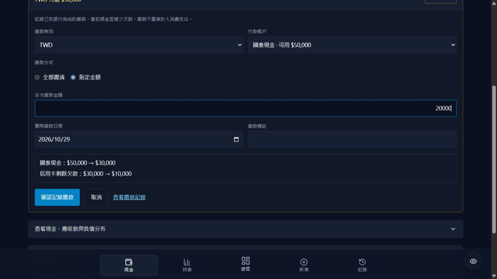

# 信用卡繳款

現金頁新增「信用卡欠錢」繳款面板，帳戶清單的信用卡列也有入口。選擇幣別及實際現金來源，再選全部繳清或指定金額，即可預覽付款帳戶與欠款的前後金額，按「確認記錄繳款」保存。

這是銀行繳款完成後的記帳功能，不會向銀行發出付款。繳款記為來源現金到「信用卡欠錢」的一筆資金調動，不重複列為消費支出。資金紀錄列表以「信用卡繳款」標示。

## 金額與可靠性

- 台幣、美元分開繳款，只允許同幣別。應收款、信用卡及其他負債不能作為來源。
- 來源餘額不足、超過欠款、零／負／非有限金額及未來付款日期均會阻止保存；指定金額最多兩位小數。
- 全部繳清若在確認時欠款已有變更，要求重新確認金額，避免默默多扣。
- 現金餘額有未儲存校正，或全站仍有未確認的帳務操作時，先完成／處理該操作再新增繳款。
- 新 API `POST /api/manual/credit-card-payments` 僅供登入使用者。先讀 revision 和最新現金，再透過既有 `apply_app_operation` RPC 的同一交易更新兩邊餘額與紀錄；版本不同會拒絕提交。
- operation_id 隨全站佇列持久保存，成功後回應遺失可重試。重試先交回 RPC 檢查原請求，已繳清時仍能取回原成功結果，不會因再驗證餘額而被錯誤阻擋。
- 紀錄編輯也檢查沖回舊金額後的淨變動，避免修改造成溢繳或現金不足；刪除沿用既有沖回與餘額校正保護。

沒有新增資料表、欄位或 SQL migration。沿用前次已套用的帳務 migration 與服務端 service_role；正式網站需要部署新的前後端程式。

## 驗證

- 後端 136 項測試通過，包含 17 項繳款與修改紀錄檢查；正式 DB 連線在測試中封鎖。
- 前端 9 項測試通過，包含 5 項繳款計算／來源與金額檢查。
- PostgreSQL/PGlite 原子交易、重試、版本衝突、權限及建表整合測試通過。
- Production build 成功。
- 瀏覽器使用本機合成 API，實際執行部分繳款 20,000，再繳清剩餘 10,000；核對欠款 30,000→10,000→0、付款現金 50,000→30,000→20,000、餘額不足停用確認、繳款紀錄標示。合成 API 使用實際請求模型與服務驗證、替身資料庫；正式銀行與正式帳務沒有被操作。

Windows 沙盒的 asyncio socketpair 初始化阻塞，完整 Python 測試改在沙盒外執行，未放寬測試對正式資料庫的封鎖。

