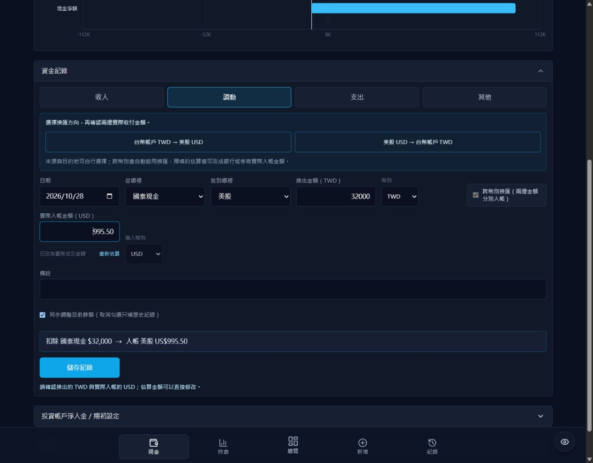

# 2026-10-28 修正說明與上線方式

本次對應 `project_review_2026-10-28.md` 的 L1–L8、D1–D7、U1–U8。依使用者要求，**L3 dividend 不處理**。其餘問題已在此工作目錄完成程式修正與本機驗證。後續使用者執行正式 migration 後，已於 Supabase 專案 `vcjfyfrvpzxztymxrbno` 唯讀核對：**50 項結構／權限／帳戶唯一性及版本表檢查全數 PASS，0 項失敗**；網站部署狀態尚未確認。這份文件描述本次修正後的行為，原稽核報告保留作為修正前基準。

## 台幣與美股的使用流程

到「現金 → 資金紀錄 → 調動」，選擇快速方向：

| 方向 | 換出金額 | 實際入帳金額 | 儲存後的帳務變動 |
|---|---|---|---|
| 台幣帳戶 TWD → 美股 USD | 例如 TWD 32,000 | 例如 USD 995.50 | 台幣帳戶減 32,000，美股淨入金加 995.50 USD |
| 美股 USD → 台幣帳戶 TWD | 例如 USD 500 | 例如 TWD 15,980 | 美股淨入金減 500 USD，台幣帳戶加 15,980 |

來源及目的帳戶可再選擇。美股帳戶固定 USD，台股固定 TWD；銀行帳戶支援兩種幣別。跨幣別自動顯示第二個金額，先依參考匯率估算，使用者可以改成銀行／券商實際入帳金額。若費用已由入帳金額扣除，直接填扣費後的金額，避免再扣一次。

表單會先顯示兩邊預計收付。手動修改後不會在重繪或重新整理時被估算值覆蓋。這是資產記帳流程，實際換匯與銀行／券商轉帳仍由使用者完成。

美股可調出的金額以「淨入金 − 持倉含費成本 + 已實現損益」檢查。獲利後提款可以讓淨入金小於零；持股尚未賣出、可用現金不足時會被擋下。交易紀錄不會因記一筆入出金而自動買賣股票。

## 修正對照

| 編號 | 修正後行為 |
|---|---|
| L1 | 淨入金與推估可用現金分開；明確填入的 0 不再被持倉成本取代，提款依可用現金檢查。 |
| L2 | 買入費用納入 FIFO 成本、現金與淨損益，明細沿用後端扣費後結果；舊 checkpoint 版本不再續用。 |
| L3 | 依要求不處理股利；主要畫面明示損益不含股利。 |
| L4 | 缺價保留未知值、列出標的，暫停完整估值／配置比例及快照；已有舊報價時沿用並顯示實際報價時間。 |
| L5 | 交易、分割事件、買入明細均以台北估值日期截止；每日快取不能跨日冒充當日結果。 |
| L6 | 雙向換匯快速設定、兩邊實際金額、固定投資帳戶幣別；前後端共同驗證。 |
| L7 | 統一待收款名稱；未知帳戶回錯誤。借入時銀行增加、待還款負債減少，避免把負債記成正資產。 |
| L8 | 直接修改改為明確儲存的餘額校正，留下前後值／原因／時間；可只補歷史而不改現金。刪改已被後續校正涵蓋的舊紀錄會保留該帳戶校正結果，並回傳提示。 |
| D1 | 一個 PostgreSQL RPC 交易完成記帳與兩邊變動；共用 revision 鎖與版本檢查避免跨裝置覆寫，失敗整筆回滾。 |
| D2 | 寫入使用唯一 operation_id，重試沿用原 ID，資料庫回傳原結果；不同內容不能冒用同一 ID。 |
| D3 | DB trigger 在原交易內增加 revision；快取、FIFO 結算以起始 revision 發布，過期重算不能覆蓋新狀態。 |
| D4 | 查詢失敗不再偽裝成空紀錄或預設基金資產，前端保留明確錯誤與重試入口。 |
| D5 | 啟用中的現金名稱＋幣別唯一；重複列先備份整併並封存。API／RPC 驗證幣別及數值；更新不存在資料回 404，批次嚴格更新、不復活已刪列；編輯帶 updated_at 防止舊頁覆蓋。帳戶名稱仍是相容既有資料的關聯鍵，透過唯一鍵及服務層存在性檢查保護，未全面改成 FK。SQL 帳務使用 numeric，關鍵加減使用 Decimal；未把所有估值浮點計算重寫為 Decimal。 |
| D6 | 快照與摘要共用投資帳戶現金；整體投入換算 TWD 並排除代管本金，自有現金／手動投資使用一致口徑。舊歷史快照不會在本次升級中自動改寫。 |
| D7 | 唯一的新 migration 位於 supabase/migrations；新環境可產生不含個人預設資產的完整建表 SQL。新表 RLS、函式執行權限只提供服務端 service_role。登入增加資料庫共用頻率限制。 |
| U1 | 餘額／淨入金使用明確儲存；全站持久佇列、換頁仍可重試、重新載入保留操作 ID；主要表單持久草稿。背景重讀不覆蓋尚未儲存欄位；明確登出清除本機草稿。 |
| U2 | 刷新失敗可見；報價／匯率時間與摘要快取時間分開。列出更新失敗標的及沿用舊價；估值不完整時 job 顯示略過快照。活躍摘要／持倉定期重讀。 |
| U3 | 小數 step、USD 總額精度與台北日期共用函式修正；新增成功建立下一筆草稿時重新計算今天日期。 |
| U4 | 首頁主要摘要預設顯示；指標增加展開提示、帳戶可直接連到持倉；帳戶／篩選放入 URL 並記住前次檢視。 |
| U5 | 全站失敗訊息、記帳表單／鍵盤、持倉卡片／表格／明細股數統一遮罩；比例維持可見。 |
| U6 | 改用淨入金、投資帳戶現金、含應收／負債淨額等名稱；自有與代管現金分開。負現金顯示警示並暫停失真配置圖，說明損益比例並非年化績效。 |
| U7 | 空白狀態、清除篩選、全部日期、搜尋 debounce、100 筆游標分頁；同日同時間以 ID 穩定排序，修改月份失效所有相關紀錄快取。 |
| U8 | 手機鍵盤焦點移入、Tab 限制、Escape 關閉並還原焦點；刷新名稱、tab 選取及排序語意、404 頁面與錯誤重試。 |

研究子專案另修正快取 scope／symbol 覆蓋／24 小時新鮮度與價格基礎 metadata；缺 metadata 的舊快取不直接使用。還原價格同步調整 OHLC，無效因子回錯誤。研究原始碼納入追蹤範圍，資料、journal、results、密鑰仍忽略，並排除 Vercel serverless 打包。

## 正式資料庫與上線

程式修正階段只以唯讀方式核對連線專案、schema、RLS 及重複帳戶，未由代理修改正式帳務或部署。使用者執行 migration 後，已再次以單一結果集驗證 SQL 核對正式資料庫，結果為 `50 checks; 0 failed`。這代表此 migration 的結構與權限檢查通過，網站與正式 API 的完整串接仍須在新版部署後核對。既有 public 表 RLS 原已啟用，這項先前的待確認疑慮並非已發現的公開外洩。

這次須協調後端與資料庫一起升級。**不要在舊版程式仍提供服務時單獨套用 migration**：舊版讀取不會排除封存帳戶列；新版則需要新 RPC。

1. 備份正式資料庫，保存目前部署版本，暫停 cron 與帳務寫入，安排短暫維護時段。
2. 在既有、已套用原 migrations 的資料庫執行 `supabase/migrations/20261028100854_reliable_ledger.sql`。此檔有完整 transaction；失敗會整筆回滾。它不會重建或清空既有交易。
3. 部署本次前後端程式及 lockfile，保留現有環境變數。確認 service_role 只在服務端。舊頁面須重新整理，以取得 operation_id 與新格式。
4. 以讀取／刷新核對三個投資帳戶與現金。觸發 `/api/jobs/refresh`，確認 revision、估值狀態及報價時間；新計算版本會略過舊 FIFO checkpoint，可再執行 settle 建立新 checkpoint。恢復 cron 與寫入。
5. migration 整併重複帳戶會保留升級前 DB 加總；原列保存在 `cash_account_merge_backup`，封存列仍在原表。若原重複列本身是誤植，需對照銀行真實餘額再做一次「餘額校正」，不能由程式猜哪筆才是真的。

若要回退，需一起處理封存列與新版已產生的帳務／校正紀錄；不要直接把舊 backend 指向升級後資料庫。原始備份提供回復依據。

全新空資料庫改用：

```powershell
python backend/scripts/database_setup.py
```

此命令只產生 `tmp/database_setup.sql`，不讀密鑰、不連資料庫。將產出 SQL 執行於新的 Supabase 空資料庫；**既有正式資料庫只跑新增 migration**，不要重跑含舊個人範例 seed 的 baseline scripts。

## 驗證

```powershell
python -m pytest backend/tests -q
python -m pytest stock_research/tests -q
npm test --prefix frontend
npm run test:db --prefix frontend
npm run build --prefix frontend
```

- 後端 119 項、研究 73 項、前端佇列與日期 4 項通過。
- `test:db` 使用 PGlite 的 PostgreSQL 引擎，驗證原 schema 升級、重複封存、再次執行安全、雙向換匯、重試去重、版本衝突、回滾、幣別及可用現金檢查、校正保護、嚴格批次更新、穩定分頁、快取 CAS、匿名權限，及全新空環境建表。
- 前端 production build 成功。Vite 8.3.5、React Router 7.18.5；套件安裝時 npm audit 為 0 項已知弱點，lockfile 已更新。
- 瀏覽器使用本機合成 API 驗證雙向換匯 payload、紀錄雙幣別顯示、小數 Enter 送出與錯誤提示、桌機與 390 × 844 手機鍵盤／焦點／隱私。頁面模擬 API 與 DB RPC 分別驗證，尚未在正式 Supabase／Vercel 做完整串接測試。
- 本機 Python 3.10，專案宣告 3.12；PGlite 不等同 Supabase 的完整服務環境，未進行多 instance 壓力測試、實體手機測試或重新跑歷史回測。


