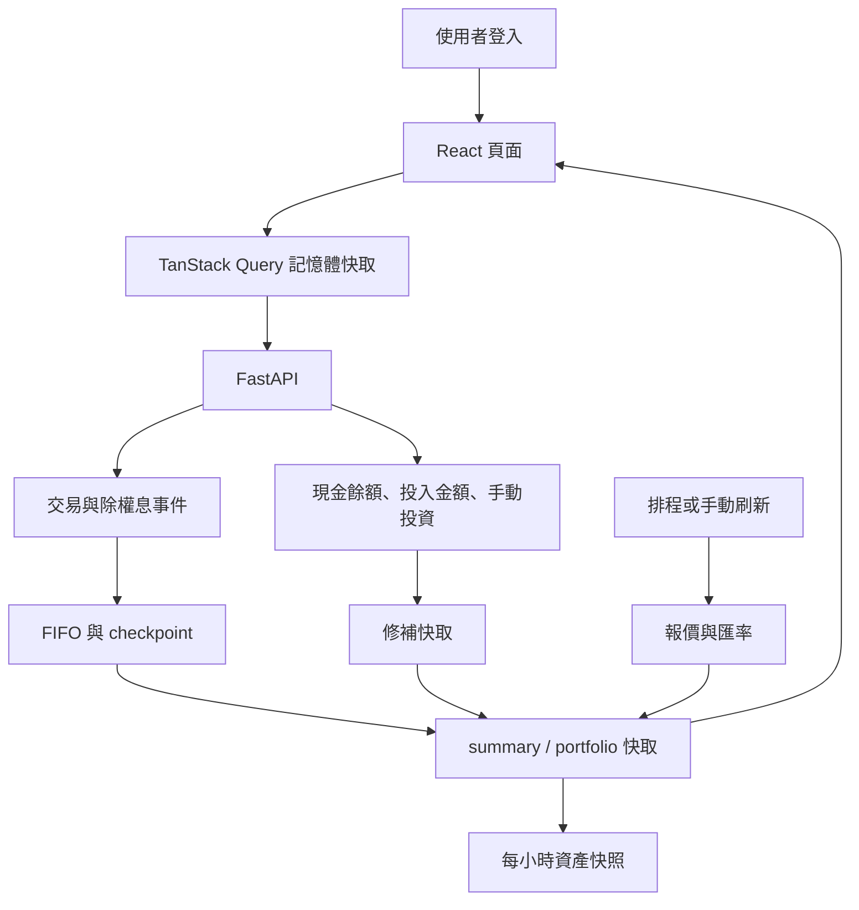
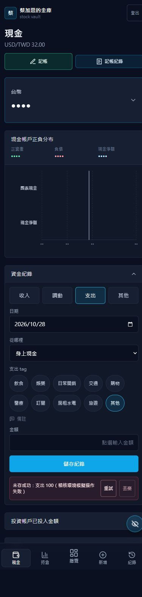
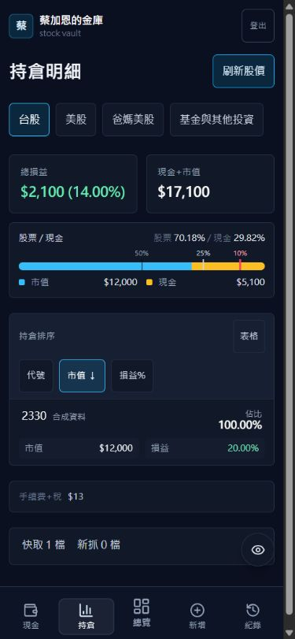

# 專案使用邏輯、UI／UX 與資料庫互動檢視

> 本文為修正前稽核基準。後續已依使用者要求修正 L3 dividend 以外的項目；實際修正、驗證及尚未執行的正式 migration／部署，請看 [2026-10-28 修正說明](fixes_2026-10-28.md)。下文的「未修改」與測試數量描述的是原始檢視當時狀態。

檢視日期：2026-10-28。工作目錄：`C:\Users\user\Desktop\python\stock_site`。分支：`main`。遠端：`datasciencefreshman2000/stock_web`。

**主要結論：現有網站已具備個人資產追蹤的主要功能，下一步應先補齊金額定義與寫入可靠性，再調整畫面的資訊層級。** 最大風險是畫面正常顯示，但現金、損益或歷史快照的計算口徑不同，使用者無法可靠對帳。

本次沒有修改正式業務程式、SQL 或部署設定；另新增本報告、合成資料截圖，及 `tmp/` 下的隔離稽核腳本。原有未追蹤文件保留原狀。

## 檢查範圍與驗證程度

- 網站核心盤點涵蓋 `frontend/src`、`backend`、`api`、Cloudflare worker：116 個 Python／JS／JSX／CSS／SQL 檔，約 12,588 行，包含測試、註解與 migration。
- 逐條追蹤登入、總覽、持倉、交易新增／修改／刪除、現金餘額、收入／支出／調動、換匯、手動投資、報價、快取、FIFO 結算與快照。
- 瀏覽器實際檢視登入及六個應用頁面；桌機與 390 × 844 手機尺寸使用本機合成資料。手機測試是瀏覽器視窗尺寸測試，未使用實體 iOS／Android。
- 既有後端測試 **105 項通過**；另以明確阻擋真實資料庫連線的替身重跑，仍為 **105 項通過**。測試使用本機 Python 3.10；專案宣告 Python 3.12，未宣稱與正式環境完全一致。
- `npm run build` 成功，Vite 8.0.11。建置成功不等於以下操作與金額問題不存在。
- 另外用記憶體替身重現金額與並行寫入問題；結果保留於 [合成測試結果](audit_assets_2026-10-28/probe-results.json)。探針沒有使用真實持倉資料。
- 未以正式 Supabase 的表結構、授權、資料列、執行計畫或正式排程狀態作為驗證依據。資料庫安全與 migration 的結論以本地程式和 SQL 為準；正式狀態需另外核對。
- `stock_research` 自述為獨立研究專案，本次另檢視資料入口、回測引擎與日誌的整合風險，未重跑歷史回測或完成其統計方法審查。`org_data`、密鑰、套件目錄及研究資料集不作為本次使用者資料樣本。

下文「已重現」表示以合成資料／瀏覽器驗證；「程式確認」表示可由現有執行路徑直接確認；「待正式確認」不表示正式環境已經出事。P1 建議優先處理，P2 為後續必要改善，P3 為體驗整理。

## 目前的使用與資料流

交易紀錄直接讀 `trades`，總覽與持倉多半讀 `summary_cache`。因此「交易紀錄看到新增資料」並不能證明「總覽與持倉已經使用同一版本資料」。現金又同時有銀行等手動餘額與投資帳戶的推估現金，這是目前最需要清楚定義的地方。

值得保留的設計：後端集中計算 FIFO、分割事件不覆寫原始交易、將報價／匯率落地、對大量交易分頁、批次建立各頁快取、將自有與代管帳戶分開，以及已有錯誤邊界和手機持倉卡片。沒有必要為了改善體驗全面重寫。

## 一、使用邏輯與金額正確性

### L1｜P1：把「已投入本金」當成「可提領現金」

**已確認的計算與檢查路徑。** `invested_帳戶` 同時用來表示投入金額、計算報酬分母、推估現金，及限制資金調出。

- 持倉頁現金公式是「投入金額 − 未賣出部位成本 + 已實現損益」。
- 調出時卻檢查「投入金額 − 調出金額 ≥ 0」，沒有檢查帳戶目前推估現金。
- 因此本金已全數買股、沒有可用現金時，仍可能允許調出；相反地，已獲利的帳戶可能有足夠現金，卻因可調出的本金不足而被擋住。
- `enrich_account_summary()` 還會把明確輸入的 0 本金改成現有持倉成本。合成例子：投入 0、持倉成本 1,000，最後回傳投入 1,000，使用者的 0 不會照實呈現。

**建議：** 分開記錄淨入金、期初現金、買賣現金流與可用現金。是否允許負現金／融資應是明確的帳戶規則。報酬率的分母也應另有定義，不能兼任餘額。

程式位置：`backend/services/accounts.py:37`、`backend/routers/manual.py:215`。

### L2｜P1：買入手續費沒有反映到帳戶總額

**已重現。** 投入 USD 2,000，買入 10 股、每股 100，買入費用 10。程式記下 `total_fee=10`，但持倉成本仍是 1,000，推估現金是 **1,000，應為 990**。股價不變時，帳戶總額會高估 10。

買入成本採不含費價格可以是顯示選擇，但真實現金仍必須扣費。現在賣出已實現損益會扣賣出費與稅，買入費則沒有透過同一公式扣回，口徑不對稱。買入明細還會自行顯示未扣賣出費稅的損益，與帳戶摘要不完全一致。

**建議：** 以交易淨收付金額更新現金，明確提供「交易價差」和「扣費後損益」，前後端共用同一份計算結果。不要只把所有費用再扣一次，否則已經算進賣出淨收入的費用會重複扣除。

程式位置：`backend/services/fifo.py:163`、`backend/services/accounts.py:52`、`frontend/src/components/holdings/HoldingTradeDetails.jsx`。

### L3｜P1：股利計算沒有完整接到資產與結算流程

**已重現兩個問題。** 合成案例持有 10 股，每股股利 2，全量重算得出股利 20；經 `_state_to_checkpoint()` 寫成結算資料再續算後，股利變成 **0**。結算序列化欄位及 SQL 沒有保存 `dividend_income`。

另外，摘要雖回傳 `dividend_income`，但 `account_total`、推估現金及主要損益沒有把它納入，也沒有「股利實際入帳」的完整流程。

**建議：** 補齊 checkpoint 股利狀態與 migration；區分除息日應收股利、實際付款日入帳股利，以及可能的扣繳／費用。現金在實際入帳時更新，不能一律在除息日當成已收款。新增「含股利總報酬」及結算前後一致性的測試。

程式位置：`backend/services/settlement.py:62`、`backend/services/fifo.py:116`、`backend/sql/migrations/20260804_platform_upgrade.sql`。

### L4｜P1：抓不到價格會把資產看成歸零

**已重現。** 成本 1,000 的持倉，缺報價時單檔市值為 `null`，但帳戶加總把 `null` 當 0，最後未實現損益成為 **−1,000**。持股並未真的歸零，也沒有證據顯示損失 100%。買入明細則把缺現價轉成 0，再產生類似的虧損。

**建議：** 保留最後有效報價與報價時間；沒有任何可用報價時顯示「估值不完整」，列出缺價標的，暫停顯示完整總損益／報酬率，或清楚標示只是已知部位小計。快照也必須保存估值完整性，避免把抓價失敗寫成歷史崩跌。

程式位置：`backend/services/calculator.py:97`、`frontend/src/components/holdings/HoldingTradeDetails.jsx`。

### L5｜P1：未來的分割與交易可能提前影響今天的資產

**已重現。** 10 股持倉加上一筆 `2099-01-01` 的 2:1 分割，現在就回傳 **20 股**。一般持倉計算沒有傳入今天的 `up_to`，FIFO 末尾又會套用所有剩餘事件直到 `9999-12-31`。

**建議：** 每次資產計算都明確帶估值日期；未來事件可以預先登記，但到生效日才影響資產。未來交易若是預計操作，應放在獨立狀態，而不是直接混入已成交紀錄。

程式位置：`backend/services/fifo.py:196`、`backend/services/settlement.py:129`；買入明細也有相同的事件時間處理。

### L6｜P1：調動的帳戶與幣別沒有一致性檢查

**已重現。** 對美股帳戶傳入「增加 1,000 TWD」，後端仍把 `invested_美股` 增加 **1,000**，但其他計算把這個值解讀為 USD。未啟用換匯的調動也可能形成這種請求。

**建議：** 投資帳戶幣別由帳戶決定；跨幣別必須提供來源金額、目的金額、兩邊幣別及實際匯率／費用。後端拒絕不一致的請求，不能只靠前端預設值。

程式位置：`backend/models.py:110`、`backend/routers/manual.py:170`、`backend/routers/manual.py:215`。

### L7｜P1：「其他」記帳可能留下紀錄卻沒有調整餘額

**已重現於沒有同名自訂現金列的情況。** 前端提供「社團欠錢」「公司欠錢」「外面欠錢 (待還款)」，後端預設辨識的名稱卻包含「社團欠錢 (待收款)」「公司欠錢 (待收款)」。無法辨識的 bucket 直接忽略，新增紀錄仍可能成功。

此外，「待收款」與「待還款」需要不同的資產／負債方向，不能都以正金額加到目的地。

**建議：** 用固定帳戶 ID 連結，顯示名稱可變；另存交易種類，例如借出、借入、收回借款、償還借款。未知帳戶必須回錯誤，並讓每種操作先顯示預計的餘額變化。

程式位置：`frontend/src/components/cash/constants.js`、`backend/services/accounts.py`、`backend/routers/manual.py:170`。

### L8｜P2：直接改餘額與記帳共用同一數字，無法完整對帳

**程式確認。** 現金頁可直接覆寫餘額，甚至一鍵歸零；這些操作沒有產生調整紀錄。之後刪除以前的一筆支出，又會以舊支出金額沖回「現在的餘額」。若這中間手動校正過餘額，結果未必符合使用者期待。

**建議：** 把手動修改改為「餘額校正」，保存校正前後金額、時間與原因。第一次使用要有期初餘額／期初持倉；歷史補登交易也應區分「納入今天現金」與「只補歷史」。批次歸零提供影響預覽、明確確認與可沖回的調整紀錄。

程式位置：`frontend/src/pages/Cash.jsx:170`、`backend/repositories/manual.py:42`、`backend/routers/manual.py`。

## 二、資料庫互動與可靠性

### D1｜P1：資金移動不是一個資料庫交易，同時操作會遺失更新

**並行覆寫已用記憶體替身重現。** 餘額 100，兩個請求各扣 10，兩邊都先讀 100，再各寫 90，最終是 **90，應為 80**。

目前流程是寫入移動紀錄、逐筆更新餘額、最後修補快取；失敗時以 Python 補償還原。中途程序終止、還原本身失敗或其他請求已更新同一列時，這種補償無法保證原子性。前端佇列只能序列化當前頁面的操作，保護不到另一個分頁、手機或 serverless instance。

**建議：** 用一個資料庫函式／RPC，在同一個 transaction 中鎖定受影響帳戶、檢查幣別與可用餘額、寫入紀錄及兩邊變動。先將現金以外的顯示快取排除在這個核心交易之外，再以版本／持久化工作紀錄可靠刷新快取。

程式位置：`backend/routers/manual.py:157`、`:215`、`:287`。

### D2｜P1：沒有防止重複入帳的機制

**程式確認；未對正式環境製造重複交易。** 新增交易與資金紀錄沒有客戶端操作 ID 或唯一去重鍵。若資料已寫入，回應遺失或後續快取更新失敗，使用者看到失敗再重試，就可能新增第二筆。`useSaveQueue` 明確提供重試，因此這個情境會出現在正常的錯誤恢復流程。

**建議：** 每次使用者操作先產生 `operation_id`，資料庫設唯一限制；重試沿用同一 ID，回傳原操作結果。交易寫入成功後，快取失敗要回報「已儲存，摘要同步中」，避免引導使用者再次新增。

程式位置：`backend/routers/trades.py:99`、`backend/routers/manual.py:157`、`frontend/src/hooks/useSaveQueue.js`。

### D3｜P1：舊的重算結果可能覆蓋新的資料狀態

**程式確認，並行情境尚未在正式資料庫壓測。** `rebuild_all_caches()` 與 cash patch 會先讀資料／舊快取，再整包 upsert；沒有資料版本比對或跨 instance 的協調。

可能順序：刷新讀到舊交易 → 使用者新增交易並清快取 → 舊刷新完成，將舊持倉重新寫回。之後讀快取就又看到舊數字，直到下一次成功重建。現金 patch 與刷新同時執行也有類似問題。

**建議：** 設定 durable 的資料 revision；重算記下起始 revision，只有版本仍相符才發布快取，否則重試。將快取版本與估值時間一起回傳，各頁能辨識是否使用同一版本。程序內 mutex 不足以涵蓋多個 Vercel instance。

程式位置：`backend/routers/jobs.py`、`backend/services/cache_patch.py`、`backend/repositories/summary_cache.py:122`。

### D4｜P1：資料庫錯誤被包裝成「沒有紀錄」或舊預設資產

**已用替身重現。** 資金紀錄查詢拋例外時回傳 `[]`；手動投資查詢失敗但舊手動值可讀時，回傳三筆 legacy 投資與預設成本。超時、權限錯誤、資料表不存在沒有被區分。

使用者可能誤以為這個月沒記帳，或基金市值真的變成 0，甚至這些替代值被拿去寫快照。

**建議：** 真正沒有資料才回空清單。查詢失敗回明確錯誤；若保留上次成功資料，要附過期／降級狀態。只對已辨識的舊 schema 錯誤使用相容處理，避免以任何例外觸發假資料。

程式位置：`backend/repositories/manual.py:98`、`:215`，選項查詢也有廣泛吞錯。

### D5｜P2：資料庫限制沒有完整保護業務規則

**本地 SQL／API 確認，正式 schema 待核對。**

| 項目 | 現況與影響 | 建議 |
|---|---|---|
| 現金帳戶唯一性 | `(name,currency)` 只有一般索引，沒有唯一限制；同名列可能被 UI 覆蓋顯示，但總覽仍全部加總 | 適當的帳戶 ID、所有者與幣別唯一鍵，遷移前先查重 |
| 移動帳戶關聯 | `from_bucket`／`to_bucket` 是名稱字串 | 使用 FK／明確的外部收入與支出端點種類 |
| 幣別與數值 | 多個 API 接受任意幣別、負手續費或不完整換匯組合 | API 與 SQL 共同限制允許值及跨欄位規則 |
| 查無資料的更新 | 多個 update 在沒有回傳列時仍組出成功 payload | 真正不存在時回 404，避免「已儲存」但沒有寫到資料 |
| 批次投資更新 | 名為 update，實際使用 upsert；已刪除列可能被舊頁面重新建立 | 嚴格更新既有 ID，搭配 row version 檢查 |
| 金額精度 | SQL 是 numeric，但 Python 核心改成 float | 錢使用 Decimal／明確捨入規則，股數另定精度 |

### D6｜P2：歷史快照的現金、幣別及所有權口徑不一致

**已重現。** 單一帳戶快照頂層 `cash_twd` 是推估現金，`allocation.cash_twd` 卻取手動現金帳戶。合成案例同一快照得到 **1,000 與 0**。

總覽快照的 `invested_twd` 直接加總台幣與美元原數字，也包含代管帳戶。例：自己投入 TWD 10,000、USD 1,000，另有代管 USD 500，會寫成 **11,500 TWD**；自己的投入按匯率 32 應是 **42,000 TWD**。總覽快照還把自己的總資產填入 `market_value`，語意不等於股票市值。

**建議：** 快照使用統一的、已換算且明確所有權範圍的摘要；保存期別版本、報價完整性及金額定義。先修正再做淨值曲線或歷史績效，避免用錯資料評估策略。

程式位置：`backend/repositories/snapshots.py:70`、`:80`、`:93`。

### D7｜P2／待正式確認：權限與新環境建置不夠可重現

本地所有 SQL 未找到 `ENABLE ROW LEVEL SECURITY`、policy 或撤銷 public roles 權限的設定。這不代表正式資料庫一定開放；但若表位於 exposed schema 且 anon／authenticated 有 grant，網站自己的登入不會保護直接存取 Data API 的路徑。Supabase 官方也要求對 exposed schema 的表設定適當 RLS／授權。[官方說明](https://supabase.com/docs/guides/database/postgres/row-level-security)

`schema.sql` 又不是完整最新基線：缺 `summary_cache`、`fx_rates`、`fifo_checkpoints`、`tickers`、`corporate_actions`、`job_runs`、`capital_movements` 等，README 對全新資料庫與舊庫的建置說明容易讓人少跑 migration。

**建議：** 核對正式 grants／RLS，採符合目前單一擁有者、後端 service key 的權限模型；不必因此強行改成多人系統。提供單一、可重複驗證的建置流程與 schema 版本檢查。另核對登入端點部署層是否有速率限制，不能把密碼雜湊耗時當成完整的防暴力嘗試措施。

## 三、UI／UX 與日常操作

### U1｜P1：儲存狀態不一致，換頁可能丟失輸入或失敗項目

**程式確認。** 現金餘額輸入等 800ms 才排入保存；元件卸載只清掉 timer，沒有 flush，快速換頁時尚未送出的值會消失。`manual.data` 重讀也會整包替換 drafts，可能覆蓋編輯中的內容。

記帳的 pending／failed 清單只存在頁面內的記憶體；普通換頁未必立即取消已開始的網路請求，但刷新、關閉頁面後沒有可靠恢復機制，失敗項目的重試入口也會消失。基金則採明確按「儲存變更」，同一網站存在三種不同保存規則。

**建議：** 統一顯示「未儲存／儲存中／已儲存／失敗」，把傳送佇列提升到應用層並保存可恢復的草稿；只在真的有未保存內容時提醒離開。自動保存需在失焦／換頁時安全 flush，資料重讀不得覆蓋 dirty 欄位。金融資料在瀏覽器的持久化也要遵循現有登入與清除規則。

程式位置：`frontend/src/pages/Cash.jsx:41`、`:46`、`:124`、`frontend/src/hooks/useSaveQueue.js`。

### U2｜P2：刷新失敗沒有可見回饋，更新時間又可能誤導

**瀏覽器已確認。** 隔離端點回 503，持倉頁的「刷新股價」轉回可按狀態，但沒有顯示錯誤。`useRefreshAll()` 已回傳 error，總覽與持倉卻沒有取用。

此外，改現金也會更新 `summary_cached_at`，首頁就可能顯示「剛剛」，但股票報價仍是舊的。抓不到部分報價時，job 仍可能回 `ok=true`；頁面底部只有檔數，不容易知道哪一檔失敗。

**建議：** 頁首顯示更新結果、缺價標的與「目前保留上次報價」；分開呈現「帳務更新時間」「報價時間」「匯率時間」。以使用者能採取的行動取代單純快取統計。活躍頁面可定期重讀後端快取；現有 `staleTime` 不是自動刷新計時器。

### U3｜P2：小數輸入、幣別顯示與日期有具體缺陷

- **已重現：** 桌機數字 input 沒有設定 `step`。在價格欄位保持焦點輸入小數後按 Enter，瀏覽器回報 step mismatch，無法依設計的鍵盤流程送出。點送出按鈕失焦後可能通過；不能一概說所有小數都不能新增。
- **已重現：** 美股單價 100.25、1.5 股，表單下方顯示台幣格式的「交易總額 $150」，未使用 USD 格式，也隱藏了小數。
- **程式確認：** 新增交易與記帳的 `today` 使用 UTC `toISOString()`，台北凌晨 00:00–07:59 可能預設前一天；又是模組載入時計算，長開跨日不會自動換日。紀錄篩選已經有本地日期 helper，應統一使用。

**建議：** 數字欄位設定符合精度的 `step` 或採受控文字解析；幣別與精度全流程一致；日期使用共用的台北／使用者日期函式，建立新草稿時重新計算。

程式位置：`frontend/src/components/cash/MobileNumericInput.jsx:81`、`frontend/src/components/TradeForm.jsx:11`、`:370`、`frontend/src/components/cash/constants.js`。

### U4｜P2：首頁與持倉把重要操作藏在看似靜態的數字內

**實際畫面檢視。** 首頁要點總資產卡片才看得到其他摘要；持倉要點總損益／現金加市值才展開細項，缺少清楚的展開提示。首頁圓餅圖比各帳戶的實際狀態更早出現；快速摘要也不能直接帶到指定帳戶持倉。

**建議：** 首屏固定顯示總資產、可用現金、含費損益、資料完整性。卡片旁用「查看組成」或明確箭頭；點帳戶直接進該帳戶。圖表保留在下方，摘要數字有清楚加總關係。

持倉頁帳戶及紀錄篩選目前只存在 component state，切出去回來容易回到台股／最近七日。建議放到 URL query，支援返回、分享特定檢視，以及新增交易後「查看這筆交易／此帳戶持倉」。

### U5｜P2：隱藏金額模式沒有涵蓋整個操作流程

**瀏覽器已重現。** 隱藏後，記帳失敗訊息仍顯示「未存成功：支出 100」。資金紀錄使用的數字鍵盤也沒有完整傳遞 privacy 的 masked 狀態。現有金額遮罩在持倉頁仍顯示股數，與紀錄頁的行為不同。

**建議：** 先定義隱私模式要隱藏哪些資訊，再共用格式化元件，涵蓋失敗標籤、表單、鍵盤、圖表、提示及輔助文字。百分比是否保留可依既有產品意圖決定，但行為要一致。

### U6｜P2：金額名稱與報酬率需要更清楚

- 「現金」同時可能指銀行餘額、應收款、負債抵減後淨額，或投資帳戶推估現金。建議分成「可立即使用現金」「應收款」「負債」「投資帳戶現金」。
- 前端首頁現金用全部 `cash.twd_equivalent`，後端自有總資產卻排除代管現金。若資料有代管現金，卡片與總資產分布可能加不回去。
- 負的投資現金在比例圖被 `Math.max(...,0)` 截成 0；使用者需要看到負債／資料缺口提示，而不是正常的 100% 股票配置。
- 目前「總損益 ÷ 投入金額」是一個簡單比率；入金、出金或改本金就會改變分母，不應讓人誤以為是完整的歷史績效。先標示計算方式，之後有完整現金流才能做資金加權／時間加權報酬。

### U7｜P2：交易紀錄缺少明確空白狀態與查找便利性

**瀏覽器與程式確認。** 沒有符合篩選的交易時，手機只看到篩選區，沒有「最近七日沒有交易」或「清除篩選」提示。代號逐字輸入就查詢；後端一次把符合篩選的所有交易讀回，前端再全部排序／呈現，沒有畫面分頁。

**建議：** 加空白狀態、筆數、全部日期、重設篩選與搜尋 debounce；大量紀錄採伺服器游標分頁。編輯日期跨月份時，同時失效來源及目的月份快取；目前記帳頁只更新當前月份，目標月份若已在快取可能暫時看不到移入的紀錄。

### U8｜P3：可及性與一致性仍有整理空間

- 手機數字對話框雖有 `role=dialog`，缺開啟時移入焦點、Tab 焦點限制及關閉後焦點還原；本次觀察開啟後焦點仍留在背景按鈕。
- 手機總覽刷新只有圖示、缺可辨識名稱；部分 tab 缺 selected／tab 語意，排序缺 `aria-sort`。
- 全頁左右滑與鍵盤切頁雖已有避開輸入框／橫向捲動的邏輯，仍應配合未保存草稿保護，並提供可理解的操作提示。
- 未知網址沒有 fallback route，登入後可能只剩外框。應提供找不到頁面與返回入口。
- ErrorBlock 沒有統一重試動作；投入金額的桌機失焦保存缺成功／失敗回饋。

## 四、研究子專案與維護補充

這些項目不在目前網站導覽的主要執行路徑，但若要把研究結果接回網站，應先處理。

1. **資料快取缺查詢條件與新鮮度資訊。** `stock_research/research/core/data.py` 不論查哪些 symbols 都共用 `price_history.parquet`。先查少量標的寫快取，再查全部可能只得到前次子集；已有快取又不會回頭補缺資料。建議保存 universe、日期區間、來源、建立時間與完整性，缺標的／區間才補抓。
2. **還原價與原始 OHLC 可能混用。** `load_from_supabase()` 只把 close 換成 adj_close，open／high／low 仍是原值；回測引擎又用 open 成交、close 估值。需統一調整因子，否則分割／除息附近可能產生人造報酬。這是程式路徑風險，未對真實行情量化影響。
3. **本地研究程式未納入主 repository。** `stock_research/` 整個被 `.gitignore` 排除。若希望結果能被重現，應將原始碼／測試納入獨立 repo 或明確的受控來源，只忽略資料與輸出。未來匯入網站的研究結果必須保存來源、資料版本與是否合成的標記。
4. **規格文件已有漂移。** 舊規格含 `x` 帳戶，現行 UI／摘要只有三個投資帳戶，而 SQL 仍容許 `x`。舊快取文件描述不自動 focus 刷新，現行 queryClient 已開啟。應將文件標示為歷史設計或更新成現況，避免後續開發恢復已移除邏輯。若資料庫仍有 `x`，要明確定義封存／排除，不宜靜默遺漏。

## 五、建議的目標使用流程

| 使用情境 | 建議的操作與回饋 |
|---|---|
| 第一次使用 | 建帳戶、選幣別與自有／代管、輸入期初現金及持倉，完成一次對帳 |
| 記收入／支出 | 選來源／目的，顯示操作後餘額，送出後有持續可恢復的儲存狀態 |
| 買賣股票 | 從指定帳戶進入；記錄成交、實際手續費及淨收付；同時更新現金與持倉 |
| 換匯與調動 | 同時顯示兩邊幣別、實際收付金額及費用；一次交易完成兩邊入帳 |
| 更新基金現值 | 明確標示手動估值時間，更新估值不影響現金；申購／贖回另記資金流 |
| 發現餘額不同 | 建立校正紀錄，顯示差額與原因，保留可追查的歷程 |
| 報價暫時失敗 | 保留最後有效值及時間，醒目顯示估值不完整，提供重試 |
| 看績效 | 清楚區分資產增減、淨入金、交易價差、股利與匯率影響 |

## 六、改善順序與驗收條件

**第一批：先讓數字與帳務可靠。** 處理 L1–L7、D1–D4、U1；同步修正快照 D6。核心驗收是「同一筆操作只記一次」「內部同幣別調動不改變淨資產」「費用與支出才會減少淨資產」「股利結算前後不消失」「沒有報價不等於資產為零」。

**第二批：讓使用者看懂、找得到、能恢復。** 統一保存回饋，補刷新錯誤與缺價提示，修小數 Enter／日期／幣別，修隱私模式，保留帳戶與篩選，調整首頁資訊層級與餘額校正流程。

**第三批：提高可維護性與擴充能力。** 完整 schema migration、權限驗證、金額精度與帳戶主檔、伺服器分頁、研究資料版本，再接歷史績效與新分析功能。

建議補的測試集中在未被現有 105 項涵蓋的情境：

1. 買入含費、賣出含費、持倉／現金／總資產的守恆關係。
2. 股利、分割、未來事件在全量與 checkpoint 間結果一致。
3. 缺價／舊價與估值完整性、快照不產生假崩跌。
4. 調動跨幣別、未知 bucket、負債方向與實際可用現金。
5. 同時操作、同一 operation_id 重送、中途失敗的原子性。
6. 舊重算與新寫入交錯，快取不能倒退到舊 revision。
7. 修改金額後立即換頁、失敗後重整、重試，只保存一次且草稿可恢復。
8. 台北凌晨日期、小數 Enter、金額遮罩及跨月份編輯的瀏覽器回歸測試。

以上是稽核結論與改善方案，尚未套用修正，也未對正式資料做歷史重算。
